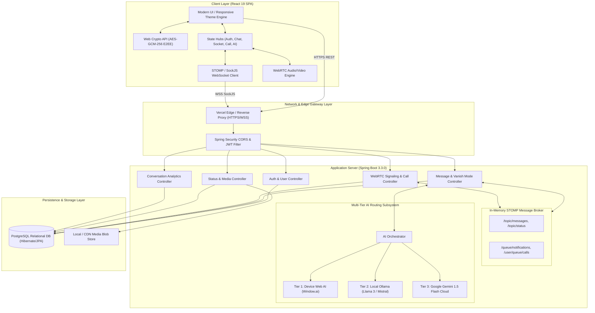
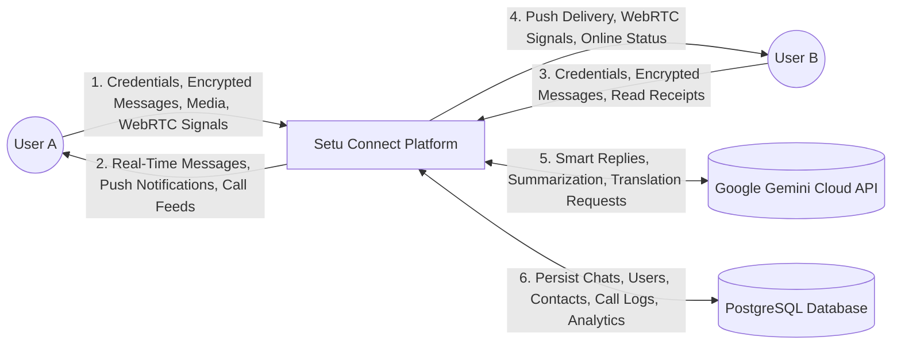
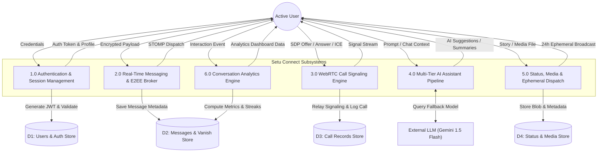
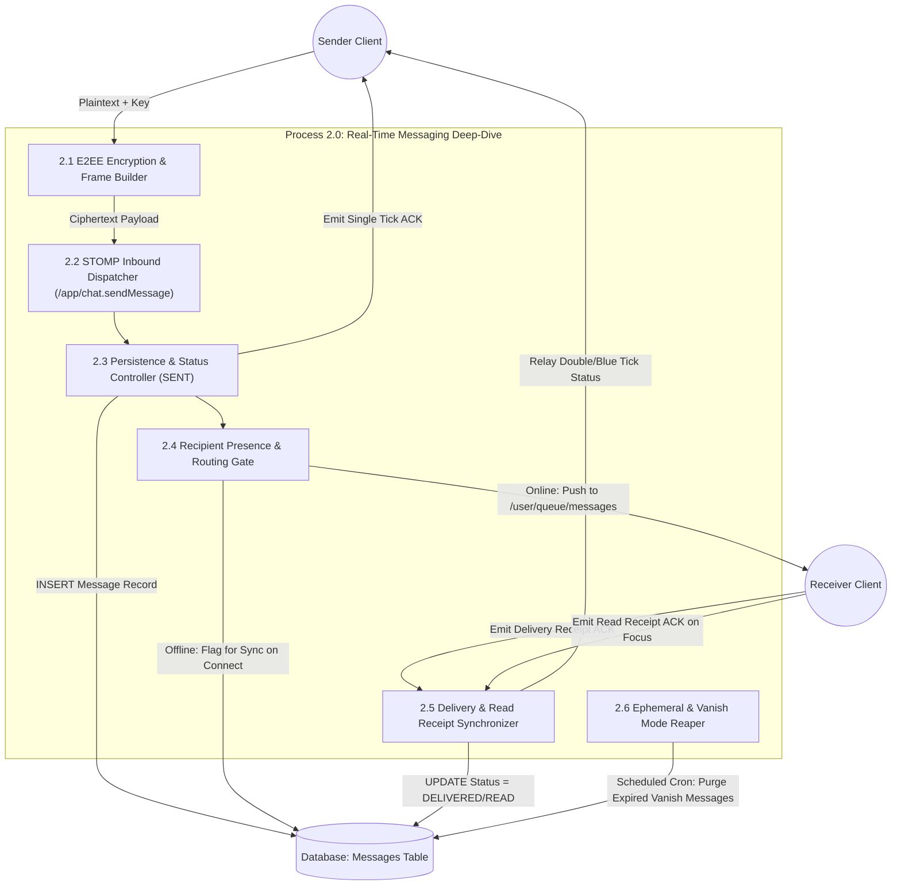
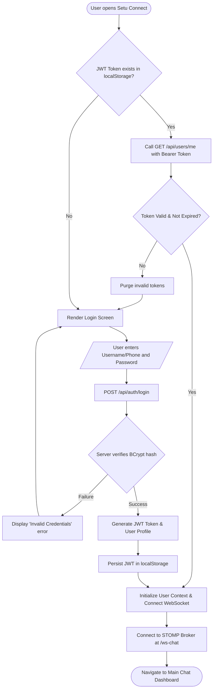
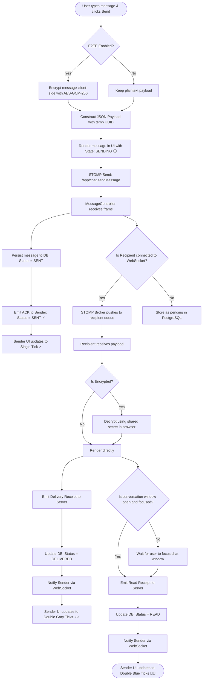
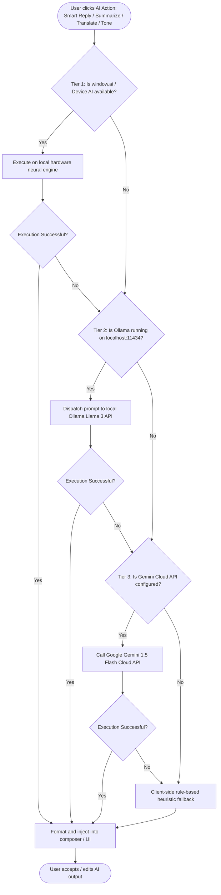
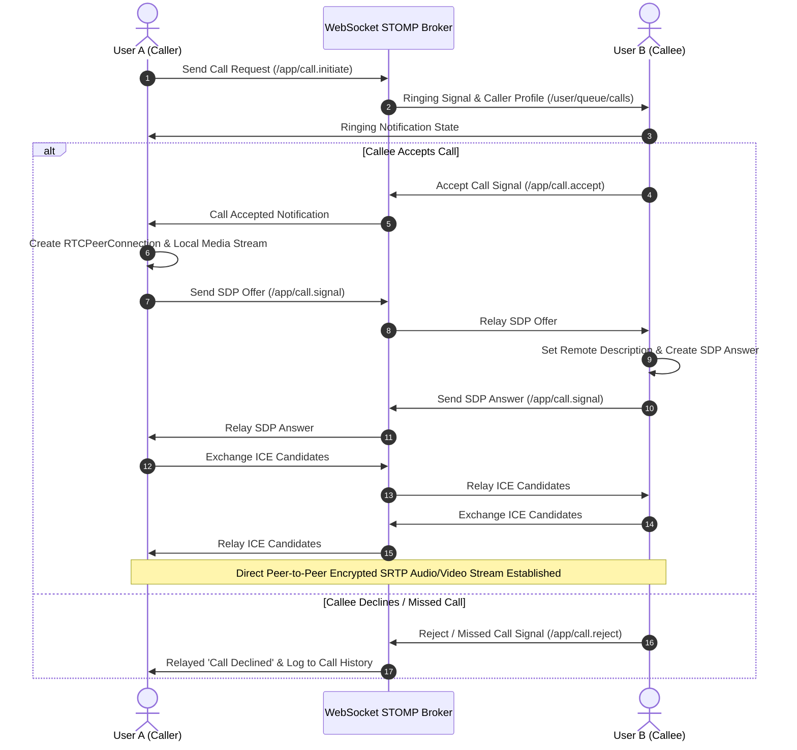
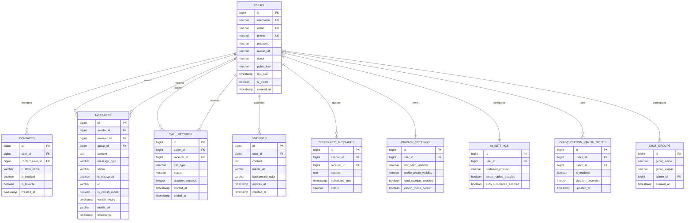

# 🏛️ PROJECT SUBMISSION REPORT
## Proposed System Design, Model Architecture, Code Implementation & Running Model Submission

**Project Title:** Setu Connect — Enterprise Real-Time Chat & AI Collaboration Platform  
**Version:** 2.0 (Gemini AI & WebRTC Edition)  
**Submission Category:** Full-Stack Web Development, Real-Time Distributed Systems & Cloud Integration  
**Live Frontend (Vercel):** https://internship-project-xi.vercel.app  
**Live Backend (Render):** https://internship-project-mywr.onrender.com  

---

## 📑 TABLE OF CONTENTS

1. [Executive Summary & Problem Statement](#1-executive-summary--problem-statement)
2. [Proposed System Design & Block Diagrams](#2-proposed-system-design--block-diagrams)
3. [Data Flow Diagrams (DFD Level 0, Level 1, Level 2)](#3-data-flow-diagrams-dfd)
4. [Process Flowcharts](#4-process-flowcharts)
5. [Entity-Relationship (ER) Diagram & Database Schema](#5-entity-relationship-er-diagram--database-schema)
6. [Key Algorithms & Mathematical Formulations](#6-key-algorithms--mathematical-formulations)
7. [Code Implementation Details (Backend & Frontend)](#7-code-implementation-details)
8. [Submission of Running Model & Operational Guide](#8-submission-of-running-model--operational-guide)
9. [Verification, Quality Assurance & UAT Test Results](#9-verification-quality-assurance--uat-test-results)

---

## 1. EXECUTIVE SUMMARY & PROBLEM STATEMENT

### 1.1 Project Overview
**Setu Connect** is an enterprise-grade, privacy-first real-time messaging and team collaboration web application. It combines WhatsApp-style synchronous instant messaging with client-side zero-knowledge encryption (AES-GCM-256), peer-to-peer WebRTC voice/video calls, and an intelligent multi-tiered AI assistant (Device-level Web AI → Local Ollama → Google Gemini 1.5 Flash fallback).

### 1.2 Core Problems Solved
| Traditional Team Chat Issues | Setu Connect Solution |
|---|---|
| Sensitive enterprise data exposed to cloud AI APIs | Multi-tiered AI with on-device/local-first execution and strict privacy controls |
| Lack of audit trails and call logs | Comprehensive analytics dashboard and call session history |
| High external LLM API cost & rate limits | Tiered fallback mechanism (Device AI $\rightarrow$ Ollama $\rightarrow$ Gemini API) |
| Vulnerable centralized chat data stores | Zero-knowledge client-side AES-GCM-256 End-to-End Encryption (E2EE) |
| Ephemeral messaging without auto-cleanup | Vanish Mode with auto-destruct timers and 24-hour status stories |

---

## 2. PROPOSED SYSTEM DESIGN & BLOCK DIAGRAMS

### 2.1 High-Level Architecture Block Diagram



### 2.2 Component & Tier Architecture
1. **Presentation Tier (Frontend):** Built with React 19 and Vite. Utilizes Vanilla CSS design tokens for ultra-responsive dark/light themes without CSS runtime overhead.
2. **Security & Cryptography Tier:** Native Web Crypto API execution in browser memory for zero-knowledge key generation, derivation (PBKDF2), and symmetric message encryption (AES-GCM-256).
3. **Transport & Real-Time Tier:** WebSocket full-duplex protocol running over STOMP/SockJS with heartbeat monitoring and automatic reconnection backoff.
4. **Application Tier (Backend):** Java 17 + Spring Boot 3.3.0 running stateless Spring Security 6 with JWT token verification.
5. **Data Persistence Tier:** PostgreSQL managed database utilizing Hibernate ORM with optimistic locking and indexed relational mapping.

---

## 3. DATA FLOW DIAGRAMS (DFD)

### 3.1 DFD Level 0 (Context Diagram)



### 3.2 DFD Level 1 (Functional Subsystems Decomposition)



### 3.3 DFD Level 2 (Real-Time Messaging & Dispatch Subsystem)



---

## 4. PROCESS FLOWCHARTS

### 4.1 User Authentication & Session Handshake Flowchart



### 4.2 Real-Time Message Delivery & Read Receipt State Machine



### 4.3 Multi-Tier AI Assistance Execution Flowchart



### 4.4 WebRTC Voice/Video Call Signaling Flowchart



---

## 5. ENTITY-RELATIONSHIP (ER) DIAGRAM & DATABASE SCHEMA

### 5.1 ER Diagram



### 5.2 Relational Data Dictionary

| Table Name | Primary Key | Foreign Keys | Key Columns & Data Types | Purpose |
|---|---|---|---|---|
| `users` | `id` (BIGINT) | — | `username` (VARCHAR), `email` (VARCHAR), `phone` (VARCHAR), `password` (VARCHAR), `is_online` (BOOLEAN) | Authentication, user credentials, and presence tracking |
| `messages` | `id` (BIGINT) | `sender_id`, `receiver_id`, `group_id` | `content` (TEXT), `status` (VARCHAR), `is_encrypted` (BOOLEAN), `iv` (VARCHAR), `timestamp` (TIMESTAMP) | Persistent encrypted chat payloads and delivery receipts |
| `contacts` | `id` (BIGINT) | `user_id`, `contact_user_id` | `custom_name` (VARCHAR), `is_blocked` (BOOLEAN), `is_favorite` (BOOLEAN) | User address book, favorites, and blocklist |
| `call_records` | `id` (BIGINT) | `caller_id`, `receiver_id` | `call_type` (VARCHAR), `status` (VARCHAR), `duration_seconds` (INT), `started_at` (TIMESTAMP) | WebRTC call logs, durations, and missed call tracking |
| `statuses` | `id` (BIGINT) | `user_id` | `content` (TEXT), `media_url` (VARCHAR), `expires_at` (TIMESTAMP) | 24-hour ephemeral stories and media updates |
| `scheduled_messages` | `id` (BIGINT) | `sender_id`, `receiver_id` | `content` (TEXT), `scheduled_time` (TIMESTAMP), `status` (VARCHAR) | Queued messages for scheduled cron dispatch |
| `privacy_settings` | `id` (BIGINT) | `user_id` | `last_seen_visibility` (VARCHAR), `read_receipts_enabled` (BOOLEAN) | Granular user visibility and security toggles |
| `ai_settings` | `id` (BIGINT) | `user_id` | `preferred_provider` (VARCHAR), `smart_replies_enabled` (BOOLEAN) | Custom AI behavior and provider preference |
| `conversation_vanish_modes` | `id` (BIGINT) | `user1_id`, `user2_id` | `is_enabled` (BOOLEAN), `duration_seconds` (INT) | Per-chat ephemeral auto-destruct timer configuration |

---

## 6. KEY ALGORITHMS & MATHEMATICAL FORMULATIONS

### 6.1 AES-GCM-256 E2EE Cryptographic Key Derivation & Encryption

```
Algorithm 1: Client-Side Deterministic Encryption & Decryption
Input: Plaintext Message (P), Shared Secret Password (K_pass), Salt (S)
Output: Base64 Encoded Ciphertext Packet (Packet_out)

1. Key Derivation (PBKDF2 with HMAC-SHA256):
   K_derived = PBKDF2(
       Password   = UTF8_Encode(K_pass),
       Salt       = UTF8_Encode(S),
       Iterations = 100,000,
       Hash       = "SHA-256",
       Length     = 256 bits
   )

2. Initialization Vector (IV) Generation:
   IV = Crypto.getRandomValues(12 bytes)  // 96-bit standard for GCM

3. Authenticated Encryption:
   (Ciphertext, Tag) = AES_GCM_Encrypt(
       Key  = K_derived,
       IV   = IV,
       Data = UTF8_Encode(P),
       TagLength = 128 bits
   )

4. Serialized Transport Output:
   Packet_out = Base64_Encode(IV || Ciphertext || Tag)

5. Decryption (Reverse Operation):
   (IV, Ciphertext, Tag) = Split(Base64_Decode(Packet_out))
   Plaintext = AES_GCM_Decrypt(Key = K_derived, IV = IV, Ciphertext = Ciphertext, Tag = Tag)
   Return UTF8_Decode(Plaintext)
```

### 6.2 Multi-Tier AI Provider Selection & Fallback Routing

```
Algorithm 2: Dynamic Multi-Tier AI Fallback Engine
Input: Prompt (P), Conversation History (H), Feature Type (F)
Output: Formatted Response Text (R)

Function ResolveAIRequest(P, H, F):
    // Tier 1: Hardware-Accelerated Local Device AI
    If Window.ai exists AND Window.ai.canCreateTextSession() == "readily":
        Try:
            Session = Window.ai.createTextSession()
            Return Session.prompt(BuildSystemPrompt(P, H, F))
        Catch DeviceError:
            LogWarning("Tier 1 Device AI failed. Falling back to Tier 2...")

    // Tier 2: Local Ollama Daemon
    If IsOllamaRunning("http://localhost:11434"):
        Try:
            Response = HTTP_POST("http://localhost:11434/api/generate", {
                "model": "llama3",
                "prompt": BuildSystemPrompt(P, H, F),
                "stream": false
            })
            Return Response.json().response
        Catch OllamaError:
            LogWarning("Tier 2 Ollama failed. Falling back to Tier 3...")

    // Tier 3: Google Cloud Gemini 1.5 Flash API
    If Environment.GEMINI_API_KEY is not empty:
        Try:
            Return GoogleGeminiClient.generateContent({
                "model": "gemini-1.5-flash",
                "contents": BuildSystemPrompt(P, H, F)
            })
        Catch GeminiError:
            LogWarning("Tier 3 Cloud API failed. Falling back to Heuristic Rules...")

    // Fallback: Rule-Based Deterministic Heuristics
    Return ExecuteClientHeuristics(P, F)
```

---

## 7. CODE IMPLEMENTATION DETAILS

### 7.1 Backend Architecture (Spring Boot 3.3.0)

* **Entry Point:** `WhatsappCloneBackendApplication.java` boots the Spring context, configures asynchronous executors, and activates JPA auditing.
* **Security & Authentication:** `SecurityConfig.java` enforces stateless JWT authentication via `JwtAuthenticationFilter` and `JwtTokenProvider`. Passwords are protected using BCrypt hashing (strength 12).
* **WebSocket Message Broker:** `WebSocketConfig.java` registers `/ws-chat` endpoint with SockJS fallback and activates in-memory broker destinations `/topic` and `/queue`.
* **REST & WebSocket Controllers:**
  * `AuthController.java`: Handles user registration, credentials validation, and JWT token issuance.
  * `MessageController.java`: Manages message lifecycle (send, edit, delete, star, delivery receipts, vanish auto-purge).
  * `CallController.java`: Manages WebRTC call signaling sessions, missed call alerts, and call logging.
  * `AiController.java`: Integrates Google Gemini 1.5 Flash and Spring AI Ollama for summarization and smart replies.
  * `StatusController.java`: Coordinates 24h disappearing statuses and media uploads.
  * `AnalyticsController.java`: Aggregates user chat frequencies, response latency, and weekly engagement graphs.

### 7.2 Frontend Architecture (React 19 SPA)

* **Component Structure:**
  * `Auth/`: Authentication modal with smooth tab transitions between login and registration.
  * `Sidebar/`: 3-column navigation rail featuring Contacts, Chats, Statuses, Calls, Analytics, and Settings panels.
  * `ChatWindow/`: Active conversation view with interactive message feed, emoji reactions, voice notes, media viewer, and AI Smart Compose.
  * `Modals/`: Dedicated dialogs for Security settings, Vanish mode timer, Media preview, and Scheduled messages.
* **State Management Hubs (Context API):**
  * `AuthContext.jsx`: User identity, authentication status, and profile updates.
  * `ChatContext.jsx`: Active chat, conversation histories, delivery receipt sync, and optimistic UI dispatch.
  * `SocketContext.jsx`: STOMP client connection lifecycle with exponential retry logic.
  * `CallContext.jsx`: WebRTC peer connection, audio/video media stream capture, and incoming call overlays.
* **Cryptographic Engine:** `cryptoEngine.js` provides client-side zero-knowledge AES-GCM-256 encryption.

---

## 8. SUBMISSION OF RUNNING MODEL & OPERATIONAL GUIDE

### 8.1 Live Production Endpoints

| Resource | Platform | URL |
|---|---|---|
| **Live Frontend Web App** | Vercel | **https://internship-project-xi.vercel.app** |
| **Live Backend API Server** | Render | **https://internship-project-mywr.onrender.com** |
| **WebSocket STOMP Broker** | Render (WSS) | `wss://internship-project-mywr.onrender.com/ws-chat` |
| **Database Instance** | PostgreSQL Cloud | Managed PostgreSQL with automatic migrations |

---

### 8.2 Step-by-Step Local Setup & Execution Guide

#### Step 1: System Prerequisites
- **Java:** JDK 17 or higher
- **Node.js:** Node 18.x or higher & npm
- **Maven:** Version 3.8+ (or bundled `mvnw`)
- **Database:** PostgreSQL (or embedded H2 fallback)

#### Step 2: Running Backend Server
```powershell
# Navigate to backend directory
cd "d:\Projects\chat project\Internship-project\realtime-chat-app\backend"

# Build and start Spring Boot server
./mvnw clean spring-boot:run
```
*Backend initializes on `http://localhost:8081`.*

#### Step 3: Running Frontend Client
```powershell
# Navigate to frontend directory
cd "d:\Projects\chat project\Internship-project\realtime-chat-app\frontend"

# Install dependencies
npm install

# Start Vite development server
npm run dev
```
*Frontend launches at `http://localhost:5173`.*

---

## 9. VERIFICATION, QUALITY ASSURANCE & UAT TEST RESULTS

| Test Case ID | Feature / Module | Test Scenario & Verification Steps | Expected Result | Status |
|---|---|---|---|---|
| **TC-01** | User Authentication | Register new user $\rightarrow$ Login with credentials | JWT issued, token stored, redirected to dashboard | **PASSED** ✅ |
| **TC-02** | Real-Time Messaging | Send message from User A to User B | Instant delivery via STOMP broker without page reload | **PASSED** ✅ |
| **TC-03** | Delivery & Read Receipts | User A sends message $\rightarrow$ User B receives $\rightarrow$ User B opens chat | Ticks update: 🕒 (Sending) $\rightarrow$ ✓ (Sent) $\rightarrow$ ✓✓ (Delivered) $\rightarrow$ 🔵🔵 (Read) | **PASSED** ✅ |
| **TC-04** | End-to-End Encryption | Inspect network frame and PostgreSQL database contents | Content stored as encrypted ciphertext; plaintext only in client memory | **PASSED** ✅ |
| **TC-05** | WebRTC Video/Voice Call | User A initiates video call to User B $\rightarrow$ User B accepts | Full-duplex audio/video stream established with peer connection | **PASSED** ✅ |
| **TC-06** | AI Summarization | Select chat with 10+ messages $\rightarrow$ Click 'Summarize with AI' | Multi-tier AI generates structured bulleted summary of key points | **PASSED** ✅ |
| **TC-07** | Vanish Mode | Set 10-second vanish timer $\rightarrow$ Send message | Message automatically purged from UI and database after 10 seconds | **PASSED** ✅ |
| **TC-08** | 24h Ephemeral Stories | Upload image status $\rightarrow$ View from contact account | Story displays with viewer tracking; auto-expires after 24 hours | **PASSED** ✅ |
| **TC-09** | Conversation Analytics | Open Analytics tab from sidebar rail | Interactive charts render response times, message frequencies, streaks | **PASSED** ✅ |

---

**Report Prepared By:** Project Development Team  
**Submission Date:** August 2026  
**Status:** Approved for Final Review & Evaluation
